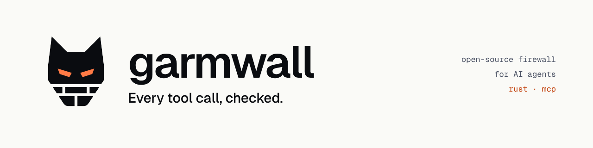
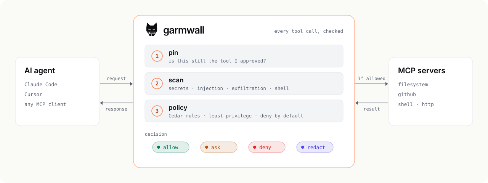
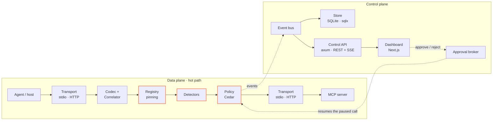

<p align="center">
  <picture>
    <source media="(prefers-color-scheme: dark)" srcset="docs/assets/readme-banner-dark.png">
    
  </picture>
</p>

<p align="center">
  <b>The open-source firewall for AI agents.</b><br>
  A Rust proxy that sits between your agent and its tools, inspects every MCP call in both directions,<br>
  and asks a human before anything risky happens.
</p>

<p align="center">
  <a href="#roadmap"></a>
  <a href="https://www.rust-lang.org"></a>
  <a href="https://modelcontextprotocol.io/specification/2026-07-28"></a>
  <a href="LICENSE"></a>
</p>

<p align="center">
  <a href="#why">Why</a> ·
  <a href="#how-it-works">How it works</a> ·
  <a href="#owasp-agentic-top-10-coverage">OWASP coverage</a> ·
  <a href="#architecture">Architecture</a> ·
  <a href="#roadmap">Roadmap</a> ·
  <a href="#known-limitations">Limitations</a>
</p>

> [!WARNING]
> **Garmwall is in early development and does not work yet.** This README describes the design and the
> target behaviour; the [roadmap](#roadmap) shows what is done. Do not rely on it to protect anything today.

## Why

AI agents don't just write text anymore. They read files, run commands and open pull requests through tools
connected over the **Model Context Protocol (MCP)**.

A language model can't tell an instruction from data. One hidden sentence in a web page, an issue or a tool
description can steer an agent: this is **prompt injection**, and it cannot be fully solved inside the model.

It turns dangerous when an agent has what Simon Willison calls the **lethal trifecta**:

| | |
|---|---|
| 🔐 **Private data** | your files, your mail, your private repositories |
| 🌐 **Untrusted content** | the web, public issues, documents you receive |
| 📤 **A way out** | HTTP requests, emails, public comments, even a markdown image URL |

With all three, a single malicious sentence can make the agent read your secrets and send them out. No bug required.

**The fix can't live only inside the model: something has to check what the agent actually *does*.**
Garmwall is that checkpoint. Every message between the agent and its tools has to pass through it.

## How it works

<p align="center">
  <picture>
    <source media="(prefers-color-scheme: dark)" srcset="docs/assets/how-it-works-dark.svg">
    
  </picture>
</p>

| Line of defence | What it stops | How |
|---|---|---|
| **1 · Tool pinning** | Rug pulls: a tool that silently changes after you approved it | SHA-256 fingerprint of name + description + schema (JCS-canonicalized), trust on first use, quarantine on change |
| **2 · Content detectors** | Prompt injection in results, leaked secrets, data smuggled out in URLs, destructive commands | Independent detectors: secrets, injection heuristics, Unicode tricks, exfiltration, shell |
| **3 · Policy as code** | Agents doing more than they should | [Cedar](https://www.cedarpolicy.com) policies, least privilege, deny by default, risk score in the context |
| **Human approval** | Risky actions (shell, CI changes, outbound requests) running unattended | The call waits until you approve or reject it from the dashboard |
| **Audit log** | "What happened, and why was it allowed?" | Every decision recorded, hash-chained, explainable |

Every call ends in one decision:
**allow** (forwarded untouched) · **ask** (paused for a human) · **deny** (a JSON-RPC error with the same request id) · **redact** (forwarded with secrets masked).

## OWASP Agentic Top 10 coverage

Garmwall is designed against the [OWASP Top 10 for Agentic Applications](https://genai.owasp.org).
Being honest about coverage matters more than claiming to cover everything.

| ID | Risk | Garmwall's answer | Coverage |
|---|---|---|---|
| ASI01 | Goal hijack | Injection detectors on results and tool descriptions | 🟡 partial |
| ASI02 | Tool misuse | Policies on arguments, human approval, rate limits | 🟢 strong |
| ASI03 | Identity and privilege abuse | Per-agent policies, least privilege | 🟢 strong |
| ASI04 | Supply chain (compromised MCP servers) | Pinning, quarantine, description scanning | 🟢 strong |
| ASI05 | Unexpected code execution | Command patterns, policies on shell tools | 🟡 partial |
| ASI06 | Memory and context poisoning | Flagging suspicious inbound content | 🟡 partial |
| ASI07 | Insecure inter-agent communication | Out of scope (possible future extension) | 🔴 no |
| ASI08 | Cascading failures | Rate limits, circuit breaker, fail-closed | 🟡 partial |
| ASI09 | Human trust exploitation | Clear approval requests with diff and risk, only above a threshold | 🟡 partial |
| ASI10 | Rogue agents | Full audit log, anomalies in the dashboard | 🟡 partial |

## Architecture

Garmwall follows the classic **data plane / control plane** split used by routers, Kubernetes and service meshes:
the data plane is the hot path every message crosses, the control plane is where you configure, observe and approve.



**Design principles**

- **Fail-closed.** If Garmwall cannot decide, the call does not pass.
- **Deny by default.** Nothing is allowed unless a policy permits it.
- **Everything is untrusted**, including the LLM's own requests: it can be manipulated, so its output is external input.
- **Garmwall is a target too.** Size limits against DoS, secrets redacted before logging, linear-time regexes (no ReDoS),
  no panics on the data plane, an authenticated control API bound to localhost by default.

<details>
<summary><b>Repository layout</b></summary>

```
crates/
  garmwall-core/      pure types: Message, Event, Finding, Decision (no I/O)
  garmwall-proxy/     transports, codec, correlator, pipeline, approval broker
  garmwall-detect/    Detector trait and all detectors
  garmwall-policy/    Cedar integration
  garmwall-registry/  fingerprints, pinning, diff
  garmwall-store/     sqlx, migrations, hash chain
  garmwall-api/       axum: REST + SSE + OpenAPI
  garmwall-cli/       the `garmwall` binary
dashboard/            Next.js
policies/             example Cedar policies and tests
tests/fixtures/attacks/  fake malicious MCP servers, used to prove attacks are blocked
docs/adr/             Architecture Decision Records
docs/brand/           logo, icons and brand guidelines
```

</details>

## Planned usage

> [!NOTE]
> Not available yet: this is the target interface for the first release.

Put `garmwall run --` in front of any stdio MCP server in your client configuration:

```json
{
  "mcpServers": {
    "filesystem": {
      "command": "garmwall",
      "args": ["run", "--", "npx", "-y", "@modelcontextprotocol/server-filesystem", "/path/to/project"]
    }
  }
}
```

The agent keeps working exactly as before. Garmwall watches every call in between.

## Built with

| Area | Stack |
|---|---|
| **Proxy** | Rust · tokio · serde · axum · reqwest |
| **Security** | cedar-policy · regex + aho-corasick · sha2 + serde_jcs |
| **Storage & telemetry** | sqlx (SQLite) · tracing · OpenTelemetry |
| **Dashboard** | Next.js · TypeScript · Tailwind CSS · shadcn/ui · TanStack Query · SSE |
| **Delivery** | distroless Docker image · Helm · cargo-dist · SBOM · cosign-signed images |

## Roadmap

Garmwall is being built in public, one milestone at a time.

- [ ] **M1** · Transparent stdio proxy: `garmwall run -- <command>` — `v0.0.1`
- [ ] **M2** · JSON-RPC codec, request/response correlation, JSONL events
- [ ] **M3** · Tool registry and pinning (rug-pull detection)
- [ ] **M4** · Detectors: secrets, injection, Unicode, exfiltration, shell, with precision/recall benchmarks
- [ ] **M5** · Cedar policies and human approvals — ★ **MVP and first public demo**
- [ ] **M6** · Control API and web dashboard
- [ ] **M7** · Streamable HTTP transport, Docker and Helm
- [ ] **M8** · ML classifier (optional)
- [ ] **v0.1** · First release

## Known limitations

Garmwall **reduces the blast radius**. It does not make agents perfectly safe, and we will always say clearly what
it does and doesn't cover.

- Heuristic detectors can be evaded, and they produce false positives.
- It only protects traffic that goes through it: an agent with direct shell access outside MCP is not covered.
- Communication between agents (ASI07) is out of scope.
- Human approval is only as good as the human reading it.

## Contributing

The project is in an early, design-heavy phase. Ideas, questions and threat scenarios are welcome: open an issue
to start a discussion.

Found a security issue? Please report it privately, not in a public issue.

## License

Licensed under the [Apache License, Version 2.0](LICENSE). See [NOTICE](NOTICE).

<br>

<p align="center">
  <picture>
    <source media="(prefers-color-scheme: dark)" srcset="docs/brand/svg/garmwall-mark-light.svg">
    
  </picture>
  <br>
  <sub>In Norse mythology, <b>Garm</b> is the hound guarding the gate: nobody passes without his permission.</sub>
</p>
